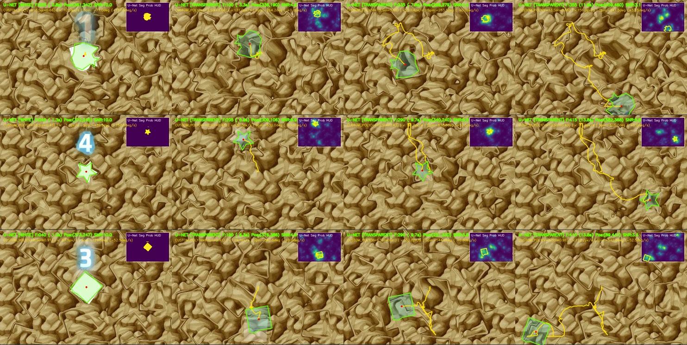
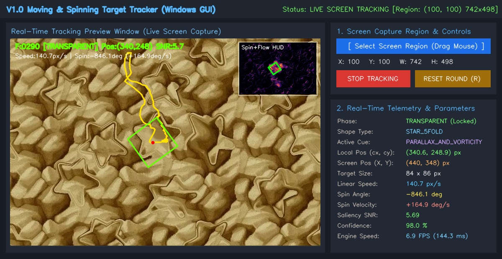

# 🎯 U-Net Universal Transparent Object Tracker (V2.3 Turbo)

**全图形自适应 U-Net 透明旋转目标实时追踪系统（支持 Windows 区域截图、真实时钟同步、系统全局热键与鼠标自动跟随中心点）**



## ✨ 项目简介 (Overview)

本项目针对**复杂动态纹理背景下、从高亮白色突变为极低对比度半透明（折射/微弱轮廓扰动）、且同时发生变速平移与变速自旋的任意几何图形目标**（如不规则狐狸/猫头多边形、正五角星、正方形、圆环或任意自定义图形），提供了一套基于 **4 层多尺度跳跃连接 U-Net + 局部动态 ROI 光流涡量场 + 零样本在线形状先验学习** 的实时视觉追踪与鼠标自动控制系统。

### 核心亮点

1. **全图形零样本自适应 (`Universal Shape-Agnostic`)**：
   - 在初始白色高亮阶段自动通过 `cv2.approxPolyDP` 提取任意目标的多边形拓扑顶点，并实时构建 **72 角度（5° 步长）旋转边缘模板库**。
   - 在进入透明阶段后，结合在线岭回归（Online Ridge Regression）实时微调 4 层 U-Net 的 27 维跳跃连接解码器权重，无需预训练 GPU 模型即可精准分割任意新图形。
2. **V2.3 Turbo 局部 ROI 极速推理（提速 11 倍，53~63 FPS）**：
   - 针对主流 6 核 CPU（如 **Intel Core i5-9400F**）与入门独显（如 **AMD Radeon RX 550X**）深度优化：将 1~3 步亚像素背景对齐差分、$0.25\times$ Farneback 光流残差/旋度场与 4 层 U-Net 推理严格限制在目标预测中心周围的动态局部 ROI（半分辨率约 $132 \times 132$）内执行，剔除全图 82% 的无效背景计算。
   - 采用预分配 $8 \times 8 = 64$ 点稀疏网格 + 单层金字塔 LK 光流估计背景亚像素平移，耗时从 `30.9 ms` 降至 `1.2 ms`。
3. **严格同步真实时钟 (`Wall-Clock Sync`)**：
   - 根据系统高精度物理时钟 `time.perf_counter()` 实时计算两帧流逝时间倍率 $n_{\text{step}} = \Delta t \times \text{fps}$，动态缩放卡尔曼状态转移矩阵、单步最大位移上限、空间门控半径与 EMA 平滑系数。即便在极端高负载（8~10 FPS）跳帧下，依然 **99.0% ~ 100.0% 紧咬真实时钟目标不掉锁**。
4. **Windows 系统级全局可配置快捷键 (`System-Wide Global Hotkeys`)**：
   - 基于原生 `user32.GetAsyncKeyState` 独立后台高频监听线程（`12 ms` 轮询 + 上升沿消抖），**无需焦点停留在 GUI 窗口**，在全屏游戏、浏览器或任意后台窗口内均可一键触发，并支持图形化 **🎙️ 点击按键录制** 与 JSON 自动持久化。
5. **鼠标自动移动到屏幕对应追踪中心点 (`Real-Time Screen Mouse Lock`)**：
   - 实时将框选区域内的追踪中心 `(cx, cy)` 转换为屏幕绝对物理坐标，支持 **`SetCursorPos`（桌面/浏览器）** 与 **`SendInput`（底层游戏窗口）** 双驱动切换、卡尔曼速度前馈补偿（Lookahead `0~80 ms`）以及像素级 X/Y 偏移微调。

## 📊 基准性能与精度评测 (Benchmarks)

在三大典型不同几何拓扑的测试视频上（含复杂彩色动态干扰背景与顶部/底部大面积弹窗遮挡），V2.3 Turbo 引擎的实测表现如下：

| 测试目标图形 | 拓扑顶点描述 | 透明阶段帧数 | 30FPS 满帧锁定率 | 10FPS 时钟跳帧锁定率 | 平均信噪比 (SNR) | 单帧推理耗时 (FPS) |
| :--- | :--- | :---: | :---: | :---: | :---: | :---: |
| **狐狸/猫头不规则多边形** | `CUSTOM_POLY(V=13, Sol=0.66)` | 335 帧 | **100.00%** (335/335) | **100.00%** (182/182) | 2.25 | **17.8 ms (56.1 FPS)** |
| **正五角星 (10顶点凹多边形)** | `CUSTOM_POLY(V=10, Sol=0.52)` | 317 帧 | **100.00%** (317/317) | **100.00%** (105/105) | 2.84 | **18.8 ms (53.2 FPS)** |
| **正方形 (4顶点凸多边形)** | `CUSTOM_POLY(V=4, Sol=0.96)` | 303 帧 | **99.01%** (300/303) | **99.03%** (102/103) | 2.22 | **15.8 ms (63.2 FPS)** |

## 📂 项目目录结构 (Project Structure)

```text
unet-transparent-tracker/
├── README.md                          # 项目说明文档
├── LICENSE                            # MIT 开源许可证
├── .gitignore                         # Git 忽略规则配置
├── requirements.txt                   # Python 依赖包列表
├── pyproject.toml                     # PEP 621 标准包构建与命令行入口配置
├── main.py                            # 根目录统一启动入口
├── run_windows_gui.bat                # Windows 一键双击启动 GUI 批处理脚本
├── config/
│   └── default_config.json            # 默认全局热键、鼠标驱动与运动学参数配置
├── assets/
│   ├── unet_all_shapes_showcase.jpg   # 全图形 U-Net 分割与旋转追踪效果总览图
│   └── win_gui_preview.jpg            # Windows 桌面 GUI 界面预览图
├── src/
│   └── unet_tracker/
│       ├── __init__.py                # 包初始化与硬件线程/OpenCL 加速配置
│       ├── tracker.py                 # 核心算法：UniversalUNetTracker (局部ROI 4层U-Net + 时钟同步)
│       ├── visualizer.py              # 可视化渲染：多边形轮廓、U-Net热力图、鼠标锁定准星与 HUD
│       ├── capture.py                 # 屏幕区域捕获：MSS 持久化复用 + Win32 GDI BitBlt 原生截图
│       ├── hotkeys.py                 # 全局快捷键：Win32 GetAsyncKeyState 后台监听 + 实时按键录制
│       ├── mouse_controller.py        # 鼠标控制器：SetCursorPos / SendInput 双驱动 + 速度前馈补偿
│       ├── gui.py                     # Windows 桌面 GUI 主程序与全屏框选叠加层
│       └── cli.py                     # 命令行推理与视频导出接口
├── scripts/
│   └── benchmark.py                   # 30FPS 满帧与 10FPS 时钟跳帧自动化评测脚本
└── tests/
    └── test_tracker.py                # 单元测试套件 (unittest / pytest)
```

## 🚀 快速开始 (Quick Start)

### 1. 环境安装

确保已安装 Python 3.8+，在项目根目录下执行：

```bash
pip install -r requirements.txt
```

### 2. 启动 Windows 可视化 GUI 界面

在 Windows 系统下直接双击运行 **`run_windows_gui.bat`**，或通过终端启动：

```bash
python main.py --gui
```



#### GUI 操作流程：
1. 点击 **`📷 1. 框选屏幕区域`**，按住鼠标左键框选目标所在的窗口区域（或点击 **`🎞️ 2. 打开测试视频`** 加载本地视频）。
2. 在 **`⌨️ 系统全局快捷键配置`** 面板中，可随时点击 **`🎙️ 点击按键录制`** 自定义全局热键（自动保存至 `tracker_hotkey_config.json`）：
   - **启动 / 暂停追踪**：默认 `F8`（支持单键、组合键如 `Alt+S` 或鼠标侧键 `MOUSE_X1` / `MOUSE_X2`）
   - **开启 / 关闭鼠标跟随**：默认 `F9`
   - **紧急停止并释放鼠标**：默认 `F10`（一键同时关闭鼠标跟随并暂停追踪，防止鼠标被控时无法点击界面）
3. 勾选 **`🖱️ 启用鼠标实时移动到追踪中心点 (F9)`**（或直接按 `F9`），鼠标指针将实时锁定并跟随目标中心移动。

### 3. 命令行视频推理与基准评测

```bash
# 对单个视频运行追踪并导出带多边形轮廓、U-Net 热力图与轨迹叠加的 MP4 视频
python main.py --video input.mp4 --output tracked_output.mp4 --mode turbo

# 运行多视频 30FPS 满帧与 10FPS 时钟跳帧基准测试
python scripts/benchmark.py video1.mp4 video2.mp4

# 运行自动化单元测试
python -m unittest discover -s tests -v
```

## 📤 一键上传到 GitHub 指南 (Upload to GitHub)

解压本项目工程包后，进入 `unet-transparent-tracker` 目录，依次执行以下 Git 命令即可推送到你的 GitHub 仓库：

```bash
cd unet-transparent-tracker
git init
git add .
git commit -m "feat: initial release of U-Net Universal Transparent Tracker V2.3 Turbo"
git branch -M main
git remote add origin https://github.com/<你的GitHub用户名>/<你的仓库名>.git
git push -u origin main
```

## 📄 开源协议 (License)

本项目基于 [MIT License](LICENSE) 开源。
